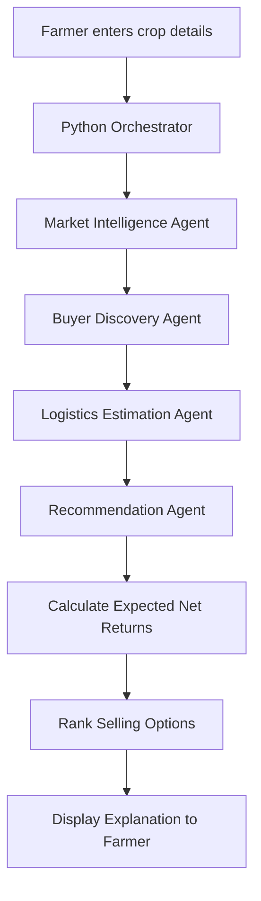

# 🔄 FarmValue AI – Agent Workflow

## 1. Introduction

FarmValue AI uses a coordinated multi-agent workflow to transform farmer-provided crop information into explainable selling recommendations.

Four specialised agents collaborate under a central Python orchestrator. Each agent handles a different aspect of the agricultural selling process.

## 2. Overall Workflow

## 3. Agent-by-Agent Execution

### Agent 1: Market Intelligence

**Input:**
- Crop type
- Farmer location
- Quantity
- Expected harvest date

**Processing:**
- Retrieve available market-price information.
- Analyse historical prices and market arrivals.
- Identify relevant market opportunities.
- Examine price trends.

**Output:**
A list of potentially suitable markets with available price information and relevant market trends.

### Agent 2: Buyer Discovery

**Input:**
- Crop type
- Quantity
- Crop quality
- Farmer location
- Market opportunities

**Processing:**
- Compare crop requirements with buyer preferences.
- Evaluate quantity compatibility.
- Consider buyer location.
- Rank potential buyer matches.

**Output:**
A list of potentially suitable buyers with matching information.

### Agent 3: Logistics Estimation

**Input:**
- Farmer location
- Market or buyer location
- Quantity
- Available transportation information

**Processing:**
- Estimate delivery distance.
- Calculate transportation expenses.
- Consider handling charges.
- Estimate potential post-harvest losses where supporting data exists.

**Output:**
Estimated delivery expenses for each selling alternative.

### Agent 4: Recommendation

**Input:**
- Market information
- Buyer matches
- Logistics estimates

**Processing:**
- Calculate expected gross sale value.
- Deduct estimated selling expenses.
- Compare net returns.
- Rank available alternatives.
- Generate explanations for the ranking.

**Output:**
Ranked selling alternatives with estimated net returns and understandable trade-offs.

## 4. Orchestrator Responsibilities

The Python orchestrator coordinates the entire workflow.

It is responsible for:
1. Receiving farmer information.
2. Validating input data.
3. Triggering the required agent tasks.
4. Passing relevant outputs between agents.
5. Handling incomplete or unavailable information.
6. Collecting final recommendations.

## 5. Illustrative Example

Consider a farmer with 1,000 kg of tomatoes.

The platform evaluates three possible selling alternatives:

| Alternative | Gross Price | Logistics Cost | Estimated Net |
|---|---|---|---|
| Local Bulk | Low | Minimal | Highest |
| Town Market | Stronger | Moderate | Moderate |
| Distant Buyer | Highest | High | Lower |

These are illustrative comparisons, not live market quotations.

The Recommendation Agent evaluates the available information and identifies the alternative with the highest estimated net return.

## 6. Explainability and Farmer Control

Every recommendation should communicate:
- Why an option was ranked higher.
- What costs were considered.
- What trade-offs exist.
- Which information is estimated or unavailable.

The platform provides decision support. The farmer retains complete control over the final selling decision.

## 7. Expected Outcome

The coordinated workflow aims to:
- Improve market awareness.
- Identify suitable buyers.
- Make hidden selling expenses visible.
- Compare selling alternatives.
- Support informed agricultural marketing decisions.

---

**FarmValue AI – AI informs; farmers make the final call.**

*Document status: Proposed multi-agent workflow for CJ100.*
