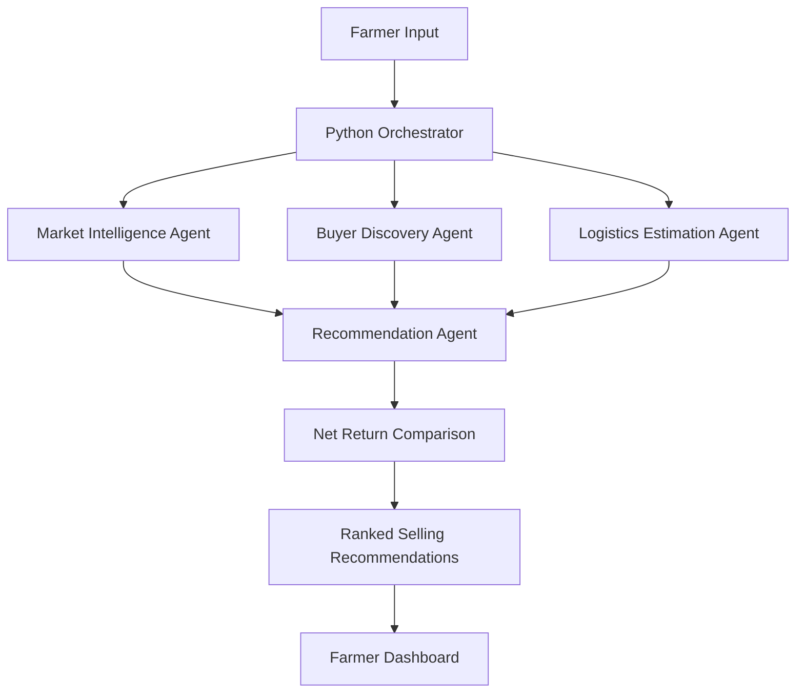

# 🏗️ FarmValue AI – System Architecture

## 1. Architecture Overview

FarmValue AI follows a modular, multi-agent architecture in which four specialised agents collaborate through a central Python orchestrator.

Each agent performs a specific task, and the orchestrator coordinates their outputs to generate a unified, explainable selling recommendation.

## 2. High-Level Architecture

## 3. Core Components

### A. Farmer Input Layer

Collects the information required to evaluate selling opportunities.

Inputs include:
- Crop type
- Quantity available
- Farmer location
- Crop quality or grade
- Expected harvest date

### B. Python Orchestrator

Acts as the central coordinator of the system.

Responsibilities:
- Receives and validates farmer inputs.
- Initiates the appropriate agent tasks.
- Coordinates information exchange.
- Combines agent outputs.
- Passes results to the recommendation stage.

### C. Market Intelligence Agent

Purpose: Identify potentially favourable markets.

Responsibilities:
- Analyse available historical market prices.
- Examine price trends and market arrivals.
- Identify demand patterns.
- Compare potential market opportunities.

Proposed techniques:
- Pandas and NumPy for data processing.
- Time-series analysis for historical trends.
- Scikit-learn for suitable predictive models.

### D. Buyer Discovery Agent

Purpose: Identify buyers whose requirements match the farmer's produce.

Responsibilities:
- Match crop type and quality.
- Compare required and available quantities.
- Evaluate buyer location.
- Identify potentially suitable buyer options.

Proposed techniques:
- Rule-based filtering.
- Attribute-based matching.
- Ranking based on buyer compatibility.

### E. Logistics Estimation Agent

Purpose: Estimate the expenses associated with reaching different markets or buyers.

Responsibilities:
- Evaluate delivery distances.
- Estimate transportation expenses.
- Consider handling and delivery charges.
- Account for potential post-harvest losses where reliable estimates are available.

Proposed techniques:
- Distance-based cost estimation.
- Rule-based calculations.
- Logistics cost comparison.

### F. Recommendation Agent

Purpose: Generate transparent selling recommendations.

Responsibilities:
- Combine market, buyer and logistics information.
- Calculate estimated net returns.
- Rank selling alternatives.
- Explain the advantages and disadvantages of each option.

## 4. Net Return Calculation

The system evaluates selling opportunities using:

**Expected Net Return = Gross Sale Value − Total Selling Expenses**

Total selling expenses may include:
- Transportation costs
- Handling charges
- Market commissions
- Estimated post-harvest losses

The recommendation is based on estimated net returns rather than gross selling prices alone.

## 5. Data Management Layer

Proposed database: PostgreSQL.

The database can maintain:
- Crop information
- Market-price records
- Buyer requirements
- Location information
- Logistics estimates
- Recommendation history

External market datasets and buyer information will be incorporated subject to availability and access.

## 6. Application Layer

Proposed interface: Streamlit.

The farmer dashboard is intended to display:
- Market price comparisons
- Suitable buyer matches
- Estimated transportation expenses
- Expected net returns
- Ranked selling alternatives
- Explainable recommendation summaries

Plotly can be used to visualise market comparisons and estimated returns.

## 7. Technology Stack

| Component | Proposed Technology |
|---|---|
| Programming | Python |
| Orchestration | Python |
| Data Processing | Pandas, NumPy |
| Machine Learning | Scikit-learn |
| Database | PostgreSQL |
| User Interface | Streamlit |
| Visualisation | Plotly |

## 8. Design Principles

- **Modularity:** Each agent has a clearly defined responsibility.
- **Transparency:** Recommendations include understandable reasons.
- **Scalability:** Additional agents and crops can be incorporated.
- **Reliability:** Data availability and uncertainty should be communicated.
- **Farmer Control:** The platform supports decisions rather than making sales automatically.

---

**FarmValue AI – AI informs; farmers make the final call.**

*Document status: Proposed system architecture for the CJ100 project.*
